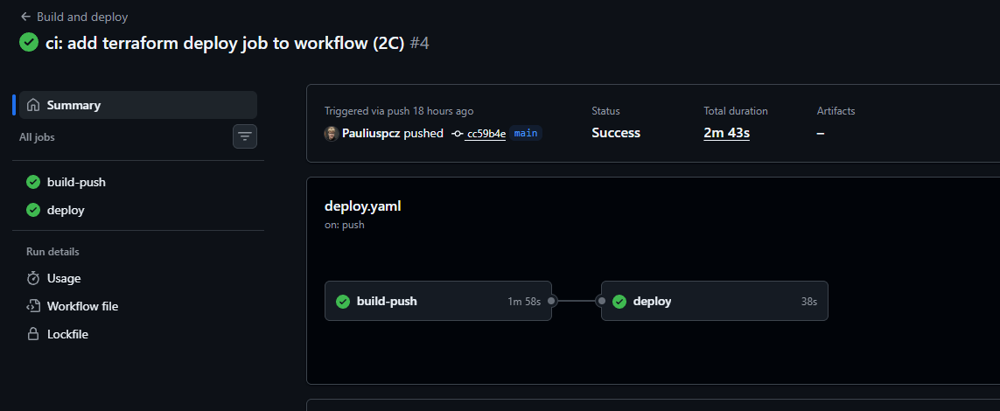
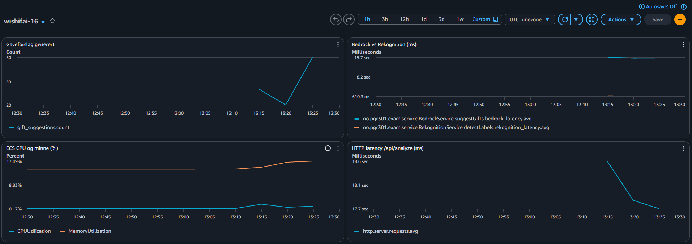

# Eksamensbesvarelse PGR301: Kandidat 16

## Oppgave 1:

### Oppgave 1A:
#### Bygg imaget fra rotmappen:

```
docker build -t wishifai .
```
#### Start containeren på localhost:9999:
```
docker run -p 9999:8080 -e AWS_ACCESS_KEY_ID=<access-key> -e AWS_SECRET_ACCESS_KEY=<secret-key> -e S3_BUCKET=<bucket-navn> wishifai
```
AWS-nøklene og bucket-navnet sendes med "-e" når containeren starter, og bygges ikke inn i imaget
#### Test at denne kjører:
```
curl http://localhost:9999/api/health
```
Dockerfilen er multistage: Maven, JDK og kildekode brukes bare i build-steget, og det endelige imaget inneholder bare jar-filen og en JRE.

### Oppgave 1B:

Lenke til grønn kjøring: [Github Actions-kjøring](https://github.com/Pauliuspcz/eksamen-2026/actions/runs/41134588964)

Imaget pushes til ECR-repoet "wishifai-16" ved hver push til main

**Tagging-strategi:** Imaget tagges med full commit-SHA (`github.sha`), se `.github/workflows/deploy.yaml` linje 38

Begrunnelse: Hver commit gir en unik tag, så jeg kan se nøyaktig hvilken commit som ligger bak imaget som kjører, for eksempel i ECR. `latest` blir overskrevet ved hvert bygg og sier ikke hvilken versjon som faktisk kjører.

AWS-nøklene ligger som Github Secrets, ikke i workflow filen.

## Oppgave 2:

### Oppgave 2A:


Offentlig URL til tjenesten: https://wi-6bb0bfedd0b24583a3268fb9f11580d0.ecs.eu-west-1.on.aws/api/health

Infrastrukturen for tjenesten deklareres i `infra/`:
- `ecs.tf`: ECS Express-tjenesten. Express mode setter opp cluster, task-definisjon, service, application load balancer, target groups, security groups og auto-scaling for meg, slik at jeg kan gå fra et image i ECR til en offentlig URL uten å konfigurere hver komponent manuelt. Tjenesten bruker de to eksisterende rollene fra oppgaven.
- `s3.tf`: bucket for lagring av bilder (`wishifai-images-16`). Miljøvariabelen `S3_BUCKET` settes automatisk fra denne i terraform-koden. 
- `iam.tf`: task-rollen `wishifai-task-role-16`, med bare de handlingene appen bruker: `s3:PutObject` på bildebucketen, `rekognition:DetectLabels`, `bedrock:InvokeModel` og `cloudwatch:PutMetricData` (for metrikkene i 3A).
- `variables.tf` og `outputs.tf`: variablene er input (region, kandidatnummer, image_tag), og outputs er returverdiene (URL-en og bucket-navnet).

### Oppgave 2B:

Terraform-state lagres i den delte S3-bucketen `pgr301-terraform-state`, se `infra/backend.tf`.

Valgt nøkkel: `wishifai/16/terraform.tfstate`

`key` er stien til min state-fil inne i bucketen. Prefikset (`wishifai/16/`) skiller min state fra andre studenters. `use_lockfile = true` ber Terraform låse state via en lås-fil i selve S3-bucketen, slik at flere ikke kan endre samme infrastruktur samtidig.

### Oppgave 2C:

Lenke til grønn kjøring: [Github Actions-kjøring](https://github.com/Pauliuspcz/eksamen-2026/actions/runs/41498559736)



Workflowen `.github/workflows/deploy.yaml` har to jobber som kjører etter hverandre `build-push` -> `deploy`. 

1. **build-push**: logger inn i ECR, bygger imaget og pusher det med commit-SHA (`github.sha`) som tag.

2. **deploy**: (`needs: build-push`) kjører Terraform i `infra/` med den nye image-taggen, som ruller ECS-tjenesten over på det nye imaget.

workflowen sjekker at formatteringen av koden er korrekt i henhold til HCL standard med `terraform fmt -check`. Er koden ikke formattert, feiler jobben før `terraform apply` kjører.

**Hvorfor Terraform kjører etter container-build:** Imaget må finnes i ECR før Terraform ber ECS om å bruke det. Kjører Terraform før eller parallelt, kan tjenesten peke på en tag som ikke finnes ennå, og deployen feiler. Med `needs:` kjører `deploy` bare hvis `build-push` er grønn. Hvis bygget feiler, blir Terraform ikke kjørt, og tjenesten fortsetter å kjøre forrige versjon.

AWS-nøklene hentes fra Github secrets på samme måte som i 1B

## Oppgave 3

### Oppgave 3A:

Metrikkene sendes til CloudWatch i namespace `wishifai-16` (`MetricsConfig.java`)

- `rekognition_latency` (Timer, `@Timed`): tiden det tar å kjøre Rekognition-kallet.
- `bedrock_latency` (Timer, `@Timed`): tiden det tar å kjøre Bedrock-kallet.
- `gift_suggestions` (Counter): antall gaveforslag generert.

**Hvorfor:** Tjenesten svarer veldig langsomt, og timerne viser hvor tiden blir av. I CloudWatch tar Bedrock-kallet ca. 16 sekunder, mens Rekognition tar ca. 1 sekund, så det er Bedrock som gjør tjenesten treg.

`gift_suggestions` er business-metrikken. Jeg valgte den fordi gaveforslagene er det brukeren faktisk får ut av Wishifai,
så den viser hvor mye tjenesten faktisk leverer, ikke bare om den svarer.

### Oppgave 3B:

Dashboard: `wishifai-16` (`infra/dashboard.tf`). Alarm: `wishifai-16-slow-bedrock` (`infra/alarm.tf`)



Dashboardet viser en miks av business-, infrastruktur- og applikasjonsmetrikker, for å gi et helhetlig bilde av tjenesten. Business-metrikken er `gift_suggestions` fra 3A. Fra ECS Express viser jeg CPU og minne, og fra Spring Boot Actuator viser jeg HTTP request-latency for `/api/analyze`. Jeg har også lagt inn timerne for Bedrock og Rekognition fra 3A, for å se hvor tiden blir av.

Et kall tar ca. 18 sekunder, og ca. 16 av dem er Bedrock. CPU og minne er lave, så det er ikke ECS som gjør tjenesten treg.

Alarmen går av når snittet for `bedrock_latency` er over 20 sekunder i 2 perioder på 60 sekunder. Jeg valgte Bedrock fordi det er det tregeste kallet, så det er her tjenesten blir tregere. Normalt tar kallet ca. 16 sekunder, så over 20 betyr at det er tregere enn vanlig. Med 2 perioder går ikke alarmen av på korte topper.

## Oppgave 4

Wishifai kan fungere helt teknisk og likevel gi dårlige svar. En LLM kan foreslå gaver som er farlige eller ikke passer for alderen,
selv om tjenesten er "grønn". DevOps-prinsippene, som samarbeid, automatisering, kontinuerlig forbedring og overvåkning, er fortsatt viktige,
men verktøyene vi bruker, som tester og alarmer, sjekker om tjenesten virker, ikke om svaret er riktig. Derfor må de tilpasses når man bruker generativ AI.

Testing er en del av en typisk DevOps pipeline, men i min løsning bygges imaget med `-DskipTests`, 
så en grønn kjøring sier ingenting om gavene gir mening. Vanlig automatisert testing forutsetter at samme input gir samme svar,
men Bedrock kan gi forskjellige svar på samme bilde. I stedet kan man kjøre et fast sett med bilder, for eksempel de i `samples/`,
og sjekke at svaret har riktig format og ikke inneholder gaver fra en forbudt-liste. Man kan også la en annen model vurdere svaret (LLM-as-judge),
eller la tjenesten moderere seg selv, slik som Comprehend-sjekken i Bedrock-laben fra forelesningene. Slike tester bør kjøre før `deploy`-jobben,
slik at ingenting kommer i prod før testene har passert. Ulempen er at en dommer-modell også er ikke-deterministisk og koster penger, så den fanger ikke alt.

For kontinuerlig leveranse er spørsmålet hva man egentlig ruller ut. Prompten ligger i koden (`BedrockService.java`),
så en endring får en ny SHA-tag og kan rulles tilbake som vanlig. Modellen velges derimot med miljøvariabelen `BEDROCK_MODEL_ID`,
så den kan byttes uten nytt image. Da viser ikke taggen hva som faktisk kjører, og model-ID burde styres som infrastruktur som kode i Terraform.
Med feature toggles kan både gammel og ny prompt ligge i koden, og en andel av brukerne får den nye gradvis. Går det dårlig, kan den slås av uten ny deploy,
slik som i Unleash-øvingen.

Overvåkning må også se på mer enn latency. Alarmen min fra 3B varsler bare når Bedrock er treg,
og den ville vært grønn selv om Wishifai foreslo en kniv til en treåring. `gift_suggestions` teller hvor mange forslag som lages, men ikke om de er gode.
Andre signaler for Wishifai kunne vært token-forbruk, siden prompten ber modellen tenke gjennom flere steg, og hvor ofte svaret ikke er gyldig JSON.
 
Hvor strenge praksisene må være, avhenger av risikoen. I en gaveliste får en feil sjelden alvorlige konsekvenser, så de automatiske testene
og overvåkning holder, og det er greit å oppdage noen feil i prod og rette dem raskt. Ved bankrådgivning eller medisinske råd holder ikke automatiske tester alene. Nye versjoner bør rulles ut gradvis,
og prompt-endringer og modellbytte bør godkjennes av et menneske i en pull request. Når kunderådgiveren bruker AI-en, bør rådgiveren se over svaret
før det når kunden, fordi det ikke er hensiktsmessig å automatisere alt.

Jeg mener derfor at DevOps-praksisene fortsatt fungerer for en AI-tjeneste, men de må utvides. 
Hvor strengt man gjør det, bør styres av konsekvensene av en feil.