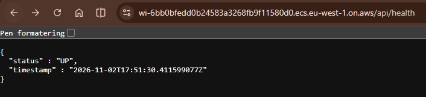

# Eksamensbesvarelse PGR301: Kandidat 16

## Oppgave 1:

### Oppgave 1A:
#### Bygg imaget fra rotmappen:

```
docker build -t wishifai .
```
#### Start containeren på localhost:9999:
```
docker run -p 9999:8080 -e AWS_ACCESS_KEY_ID=<access-key> -e AWS_SECRET_ACCESS_KEY=<secret-key> -e S3_BUCKET=<bucket-navn> wishifai
```
AWS-nøklene og bucket-navnet sendes med "-e" når containeren starter, og bygges ikke inn i imaget
#### Test at denne kjører:
```
curl http://localhost:9999/api/health
```
Dockerfilen er multistage: Maven, JDK og kildekode brukes bare i build-steget, og det endelige imaget inneholder bare jar-filen og en JRE.

### Oppgave 1B:

Lenke til grønn kjøring: [Github Actions-kjøring](https://github.com/Pauliuspcz/eksamen-2026/actions/runs/41134588964)

Imaget pushes til ECR-repoet "wishifai-16" ved hver push til main

**Tagging-strategi:** Imaget tagges med full commit-SHA (`github.sha`), se `.github/workflows/deploy.yaml` linje 37

Begrunnelse: Hver commit gir en unik tag, så jeg kan se nøyaktig hvilken commit som ligger bak imaget som kjører, for eksempel i ECR. `latest` blir overskrevet ved hvert bygg og sier ikke hvilken versjon som faktisk kjører.

AWS-nøklene ligger som Github Secrets, ikke i workflow filen.

## Oppgave 2:

### Oppgave 2A:



Offentlig URL til tjenesten: https://wi-6bb0bfedd0b24583a3268fb9f11580d0.ecs.eu-west-1.on.aws/api/health

All infrastruktur som er nødvendig for tjenesten deklareres i `infra/`:
- `ecs.tf`: ECS Express-tjenesten. Express mode setter opp cluster, task-definisjon, service, application load balancer, target groups, security groups og auto-scaling for meg, slik at jeg kan gå fra et image i ECR til en offentlig URL uten å konfigurere hver komponent manuelt.
- `s3.tf`: bucket for lagring av bilder (`wishifai-images-16`). Miljøvariabelen `S3_BUCKET` settes automatisk fra denne i terraform-koden. 
- `iam.tf`: For at tjenesten faktisk skal kunne kalle Rekognition, Bedrock og S3 trenger task-en en egen task role (ikke task execution role): `wishifai-task-role-16`, med bare tillatelsene appen trenger. 
- `variables.tf` og `outputs.tf`: variablene er input (region, kandidatnummer, image_tag), og outputs er returverdiene (URL-en og bucket-navnet).

### Oppgave 2B:

Terraform-state lagres i den delte S3-bucketen `pgr301-terraform-state`, se `infra/backend.tf`.

Valgt nøkkel: `wishifai/16/terraform.tfstate`

`key` er stien til min state-fil inne i bucketen. Prefikset (`wishifai/16/`) skiller min state fra andre studenters. `use_lockfile = true` ber Terraform låse state via en lås-fil i selve S3-bucketen, slik at flere ikke kan endre samme infrastruktur samtidig.